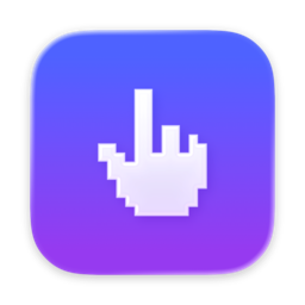

<p align="center">
  
</p>

<h1 align="center">Shortie</h1>

<p align="center">
  A menu bar app for macOS. Set up trackpad gestures, keyboard shortcuts and mouse buttons<br>
  to snap windows, control media, run scripts and more.
</p>

<p align="center">
  <a href="https://github.com/sloppyjoo/Shortie/releases/latest/download/Shortie.dmg"><b>Download</b></a> ·
  <a href="https://sloppyjoo.github.io/Shortie/"><b>Website</b></a> ·
  <a href="ROADMAP.md"><b>Roadmap</b></a>
</p>

<p align="center">
  
  
</p>

---

## How it works

Each rule has a trigger, an action, and the apps it applies to. Any trigger can run any action.

| Trigger | Action | Apps |
|---|---|---|
| A trackpad gesture, keyboard shortcut, typed abbreviation, mouse button, a click on a window's red/yellow/green button, or an event like an app opening | Open an app or website, type text, press keys, move a window, control media, change selected text, run a script, or several of these in a row | All apps, only some, or all except some |

## Features

- **Trackpad gestures:** about 70. Taps, double taps, tap and hold, TipTaps, 3–5 finger swipes, swipes in from an edge, pinches, rotation, multi-finger and corner clicks, force click. You can record a gesture instead of picking it, and Shortie warns you when macOS already uses one.
- **Keyboard shortcuts:** any key combination can run any action. Caps Lock can also work as a **Hyper key**: hold it for ⌃⌥⇧⌘, tap it for Caps Lock.
- **Window snapping:** halves, thirds, fourths, corners, Almost Maximise, Make Larger/Smaller and more, with keyboard shortcuts or by dragging a window to the edge of the screen.
- **Window layouts:** save the position of every open window under a name, then put them all back with one shortcut.
- **Window buttons:** change what the red, yellow and green buttons do, such as making green maximise instead of entering full screen.
- **Mouse:** assign actions to extra buttons, set the scroll direction separately from the trackpad, and turn on smooth scrolling.
- **Text shortcuts:** type an abbreviation like `;email` and it's replaced with the full text.
- **Selected text:** change its case, sort lines, URL-encode, search the web, read it aloud, or paste as plain text.
- **Clipboard history:** searchable, with pinning. Skips password managers and is stored only on your Mac.
- **Custom menus:** in the menu bar or at the pointer.
- **Automations:** run actions when an app opens or quits, or when your Mac wakes, sleeps, locks or is plugged in.
- **Other actions:** media keys, volume and sound output, dark mode, Dock hiding, hidden files, screenshots, a window switcher, AppleScript and shell scripts, choosing menu items, and a black menu bar to hide the notch.

<p align="center">
  
  
  &nbsp;
  
  
</p>

## Under the hood

- Written in Swift with SwiftUI and AppKit. Uses Liquid Glass on macOS 26 and later.
- Input listeners only run while a rule needs them. Idle CPU use is 0%.
- No account, no analytics, and the app doesn't connect to the internet. Settings are stored in `~/Library/Application Support/Shortie`.
- The only permission it needs is Accessibility, to read input and move windows.

## Install

[**Download Shortie.dmg**](https://github.com/sloppyjoo/Shortie/releases/latest/download/Shortie.dmg), open it, and drag Shortie into Applications. Works on Apple silicon and Intel Macs running macOS 15 or later.

Shortie isn't notarised by Apple yet, so the first time you open it:

1. macOS says it couldn't check Shortie for malware. Click **Done**.
2. Open **System Settings › Privacy & Security**, scroll down, and click **Open Anyway** next to Shortie.
3. Grant **Accessibility** permission when Shortie's welcome window asks.

Then click the hand icon in the menu bar to open settings.

> Trackpad gestures rely on macOS's private MultitouchSupport framework and may break in a future macOS update.

### Build from source

```bash
git clone https://github.com/sloppyjoo/Shortie.git
cd Shortie
open Glide.xcodeproj
```

In Xcode, choose your own team under **Signing & Capabilities**, then press **⌘R**. Building needs Xcode 27.

## Project notes

- The Xcode project and source folders still use the app's first name, **Glide**.
- [HANDOFF.md](HANDOFF.md) explains how everything is built.
- [ROADMAP.md](ROADMAP.md) lists what's done and what's next.

---

<sub>Released under the [MIT licence](LICENSE). Shortie is an independent project, not made by or affiliated with Apple. Mac and macOS are trademarks of Apple Inc.</sub>
